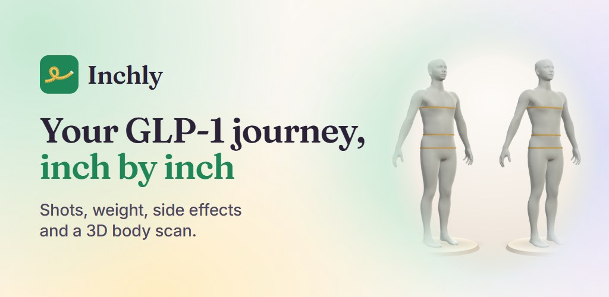
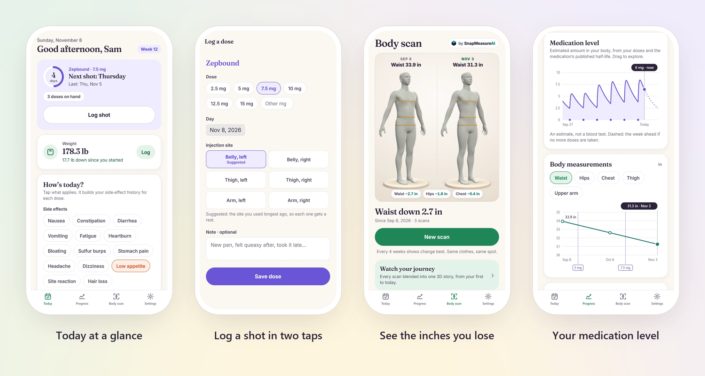

  

  <h3>The GLP-1 tracker that shows the inches the scale misses.</h3>

  Log your shots, weight and side effects in seconds. 
  Then see your body change in 3D, from two photos at home.

---

  

---

## Why Inchly

On a GLP-1, the scale can stall while your body keeps changing. Most trackers only see the number on the scale. Inchly tracks everything around your medication, **and** measures what the scale can't: your waist, hips, chest, thighs and arms, on your own 3D body.

- **Every dose, on time**: log a shot in two taps, get reminded on the day, and rotate injection sites
- **How you really feel**: side effects, food noise, protein and water in a quick daily check-in
- **The inches you lose**: a 3D body scan from two photos, no tape measure and no studio
- **Private by design**: no account, no cloud, no ads. Your log stays on your phone

---

## Features

### 💉 Shots and pills
- Weekly and daily GLP-1 medications, injections or pills
- A countdown to your next dose, with a reminder on the day
- Injection site rotation that suggests where to go next
- Doses on hand, with a nudge to reorder before you run out

### 📝 Daily check-in
- Nausea, constipation, fatigue and more, one tap each
- Food noise, from quiet to loud
- Protein and water goals that fill up as you go

### 📏 3D body scan
- Prop up your phone and follow the voice timer: one photo from the front, one from the side
- Your body in 3D in seconds, with your waist, hips and chest measured on it
- Your first and latest scans side by side, free

### 📈 Progress
- Your weight trend with every dose change marked
- Milestones and a shareable progress card
- Apple Health on iPhone, if you turn it on

---

## Free and Plus

| | **Free** | **Inchly Plus** |
|---|:---:|:---:|
| Dose log, reminders and site rotation | ✓ | ✓ |
| Weight, side effects, food noise, protein and water | ✓ | ✓ |
| 3D body scan | 1 a month | Unlimited |
| First and latest scans side by side | ✓ | ✓ |
| Estimated medication level, day by day | | ✓ |
| Any two scans overlaid, and a map of where you changed | | ✓ |
| Your journey in 3D: every scan in one replay | | ✓ |
| How each dose step went, and your goal date | | ✓ |
| Doctor report (PDF) and CSV export | | ✓ |

Inchly Plus starts with a 7-day free trial on the yearly plan. Cancel any time in your App Store or Google Play account.

---

## Works with your medication

Semaglutide (Ozempic®, Wegovy®, the Wegovy® pill, Rybelsus®), tirzepatide (Zepbound®, Mounjaro®), liraglutide (Saxenda®), orforglipron (Foundayo™), compounded semaglutide and tirzepatide, or any medication you add yourself.

---

## Private by design

| Our promise | What it means |
|---|---|
| 🔒 **No account** | No sign-up, no email, no password. Open the app and start. |
| 📱 **On your phone** | Doses, weight, side effects and scans stay on your phone. Back them up to a file you control. |
| 🗑️ **Photos deleted** | Body scan photos are processed to make your scan, then deleted. Never used for training. |
| 🚫 **No ads, no trackers** | No advertising or analytics code in the app, and nothing to sell. |

Read the full [Privacy Policy](https://getinchly.com/privacy/) and [Consumer Health Data Privacy Policy](https://getinchly.com/privacy/#health).

---

## Questions

<b>Is Inchly free?</b>

 
Yes. Logging your doses, weight and side effects, reminders and one body scan a month are free, with no time limit. Inchly Plus is optional.

<b>Can Inchly track inches lost, not just weight?</b>

 
Yes. The body scan measures your waist, hips, chest, thighs and arms from two photos taken at home, so you can see the inches you lose over time.

<b>Do I need an account?</b>

 
No. Everything you log is kept on your phone. To move to a new phone, save a backup file in Settings and restore it on the new phone.

<b>Is Inchly medical advice?</b>

 
No. Inchly is a personal log to help you see your patterns. It doesn't tell you when or how much to take. Always follow your prescriber's instructions.

More answers on the [support page](https://getinchly.com/support/).

---

## Get Inchly

**Coming soon to the App Store and Google Play.**

---

Inchly is made by SnapMeasureAI, LLC. 3D body scanning powered by [SnapMeasureAI](https://snapmeasureai.com). Inchly is a personal tracking tool and does not give medical advice; always follow your prescriber's instructions. The medication level is an estimate, not a blood test. Inchly is not affiliated with or endorsed by Novo Nordisk or Eli Lilly and Company. Ozempic®, Wegovy®, Saxenda® and Rybelsus® are registered trademarks of Novo Nordisk A/S. Mounjaro® and Zepbound® are registered trademarks, and Foundayo™ is a trademark, of Eli Lilly and Company. [Terms of Use](https://getinchly.com/terms/) · [Privacy Policy](https://getinchly.com/privacy/) · [How this site is maintained](MAINTAINING.md)
